<div align="center">

  <!-- CABEÇALHO TECNOLÓGICO -->
  

  <br />

  <!-- BADGES DE STATUS DO SISTEMA -->
  <p>
    
    
    
  </p>

</div>

---

## ⚡ `bit-window` — Terminal & Identidade Visual (16-Bit)

<div align="center">
  
</div>

---

## 👨‍💻 `about-me` — Apresentação Pessoal

```yaml
desenvolvedor:
  nome: "Enzo Ferreira de Lima"
  usuario_github: "@Enzo-FLima"
  formacao: "Bacharelado em Engenharia de Software (Cursando)"
  atuacao_atual: "Setor Cooperativo | Foco em Tecnologia e Resolução de Problemas"
  areas_de_interesse:
    - "Desenvolvimento de Software (Backend & Full Stack)"
    - "Arquitetura de Sistemas e Programação Estruturada / Orientada a Objetos"
    - "Aplicações Web Modernas e Interfaces Responsivas"
    - "Inovação Tecnológica e Inteligência Artificial"
  idiomas:
    - "Português (Nativo)"
    - "Inglês (Em estudo e aperfeiçoamento contínuo)"
  missao: "Transformar desafios reais em software bem projetado, legível e eficiente."
```

Olá! Sou o **Enzo Lima**, estudante de **Engenharia de Software** e entusiasta da construção de sistemas sólidos e bem arquitetados. Atualmente trabalho em uma **cooperativa**, experiência que fortalece diariamente minha visão prática sobre processos organizacionais, colaboração em equipe e como a tecnologia pode otimizar fluxos de trabalho reais.

Minha trajetória acadêmica e meus estudos práticos são voltados ao domínio dos fundamentos da computação — desde linguagens de base como **C** e **C++** até o desenvolvimento orientado a objetos com **Java** e tecnologias para a **Web (HTML5, CSS3 e JavaScript)**. Busco oportunidades como **Estagiário ou Desenvolvedor Júnior** onde eu possa contribuir com dedicação, evoluir tecnicamente ao lado de profissionais experientes e entregar código de qualidade.

<details>
  <summary>🌐 <b>Read in English (For International Recruiters)</b></summary>
  <br />
  <blockquote>
    <p>
      Hi! I'm <b>Enzo Ferreira de Lima</b>, an undergraduate <b>Software Engineering</b> student passionate about building clean, reliable, and well-structured software. I currently work at a <b>cooperative organization</b>, which gives me strong practical experience in teamwork, process organization, and solving real-world operational challenges.
    </p>
    <p>
      My technical studies focus on core computer science and software engineering fundamentals—spanning low-level and structured programming in <b>C</b> and <b>C++</b>, object-oriented and networked applications in <b>Java</b>, relational databases (<b>SQL</b>), and modern web interfaces using <b>HTML5, CSS3, and JavaScript</b>. I am actively studying <b>English</b> and seeking opportunities in Software Development where I can apply my problem-solving mindset and grow continuously.
    </p>
  </blockquote>
</details>

---

## 🛠️ `tech-stack` — Tecnologias & Ferramentas

<div align="center">
  
</div>

<br />

<table width="100%">
  <thead>
    <tr>
      <th width="28%" align="left">Categoria</th>
      <th width="72%" align="left">Tecnologias & Ferramentas Práticas</th>
    </tr>
  </thead>
  <tbody>
    <tr>
      <td><b>💻 Linguagens de Programação</b></td>
      <td>
        
        
        
        
        
      </td>
    </tr>
    <tr>
      <td><b>🌐 Frontend & Web</b></td>
      <td>
        
        
        
      </td>
    </tr>
    <tr>
      <td><b>⚙️ Backend, Sistemas & Build</b></td>
      <td>
        
        
        
      </td>
    </tr>
    <tr>
      <td><b>🔧 Controle de Versão & DevOps</b></td>
      <td>
        
        
        
      </td>
    </tr>
    <tr>
      <td><b>🖥️ IDEs & Sistemas Operacionais</b></td>
      <td>
        
        
        
        
      </td>
    </tr>
    <tr>
      <td><b>🌱 Em Estudo & Evolução</b></td>
      <td>
        
        
        
      </td>
    </tr>
  </tbody>
</table>

---

## 🚀 `featured-projects` — Projetos em Destaque

```text
┌──────────────────────────────────────────────────────────────────────────────────────────┐
│ $ ls -la ~/projects/public                                                               │
│ > [STATUS: PREPARANDO REPOSITÓRIOS]                                                      │
│ > Novos projetos acadêmicos e pessoais estão sendo documentados e organizados            │
│   para publicação neste espaço em breve.                                                 │
└──────────────────────────────────────────────────────────────────────────────────────────┘
```

> 🔧 **Repositórios em preparação:** No momento estou organizando a documentação, arquitetura e código dos meus projetos práticos para disponibilizá-los publicamente aqui no perfil.

<!--
==========================================================================================
TEMPLATE PRONTO PARA ADICIONAR NOVOS PROJETOS(Basta descomentar e preencher):
==========================================================================================

<table>
  <tr>
    <td width="50%" valign="top">
      <h3>🔹 Nome do Projeto 01</h3>
      <p><b>Objetivo:</b> Descrição clara e objetiva do problema que o projeto resolve.</p>
      <p><b>Principais Funcionalidades:</b></p>
      <ul>
        <li>Funcionalidade técnica 1</li>
        <li>Funcionalidade técnica 2</li>
      </ul>
      <p>
        
        
      </p>
      <p>
        <a href="https://github.com/Enzo-FLima/NOME_DO_REPO">
          
        </a>
      </p>
    </td>
    <td width="50%" valign="top">
      <h3>🔹 Nome do Projeto 02</h3>
      <p><b>Objetivo:</b> Descrição clara e objetiva do problema que o projeto resolve.</p>
      <p><b>Principais Funcionalidades:</b></p>
      <ul>
        <li>Funcionalidade técnica 1</li>
        <li>Funcionalidade técnica 2</li>
      </ul>
      <p>
        
      </p>
      <p>
        <a href="https://github.com/Enzo-FLima/NOME_DO_REPO">
          
        </a>
      </p>
    </td>
  </tr>
</table>
-->

---

## 🎯 `career-profile` — Formação, Competências & Objetivos

<table>
  <tr>
    <td width="50%" valign="top">
      <h3>🎓 Formação & Base Técnica</h3>
      <ul>
        <li><b>Graduação:</b> Cursando Bacharelado em <b>Engenharia de Software</b>.</li>
        <li><b>Fundamentos Sólidos:</b> Estudo contínuo de Lógica de Programação, Algoritmos, Programação Orientada a Objetos (POO), Sistemas Operacionais, Engenharia de Requisitos e Banco de Dados.</li>
        <li><b>Idiomas:</b> Dedicação constante ao estudo de <b>Inglês</b> para leitura de documentações técnicas e comunicação global.</li>
      </ul>
    </td>
    <td width="50%" valign="top">
      <h3>💼 Diferenciais & Objetivos Profissionais</h3>
      <ul>
        <li><b>Vivência Profissional:</b> Atuação em cooperativa, desenvolvendo senso de responsabilidade, comunicação interpessoal, organização e foco em resultados coletivos.</li>
        <li><b>Mentalidade de Engenharia:</b> Preocupação com código limpo, versionamento organizado com Git e entendimento real do problema antes da implementação.</li>
        <li><b>Objetivo:</b> Atuar como <b>Estagiário ou Desenvolvedor de Software</b> (Backend, Frontend ou Full Stack), contribuindo em projetos desafiadores e aprendendo continuamente.</li>
      </ul>
    </td>
  </tr>
</table>

---

## 📊 `telemetry` — Estatísticas do GitHub

<div align="center">
  <a href="https://github.com/Enzo-FLima">
    
  </a>
  <a href="https://github.com/Enzo-FLima">
    
  </a>
</div>

<div align="center">
  <a href="https://github.com/Enzo-FLima">
    
  </a>
</div>

---

## 📬 `connect` — Contatos & Oportunidades

<div align="center">

  <p>
    Estou sempre aberto a conexões profissionais, trocas de conhecimento, feedbacks técnicos e <b>oportunidades na área de Desenvolvimento e Engenharia de Software</b>.<br />
    Sinta-se à vontade para entrar em contato comigo pelos canais abaixo:
  </p>

  <p>
    <a href="https://www.linkedin.com/in/enzo-lima-b57418369/" target="_blank">
      
    </a>
    <a href="mailto:enzo2006lima@gmail.com">
      
    </a>
    <a href="https://github.com/Enzo-FLima" target="_blank">
      
    </a>
  </p>

  <br />

  <!-- RODAPÉ VISUAL DISCRETO -->
  

</div>

---
